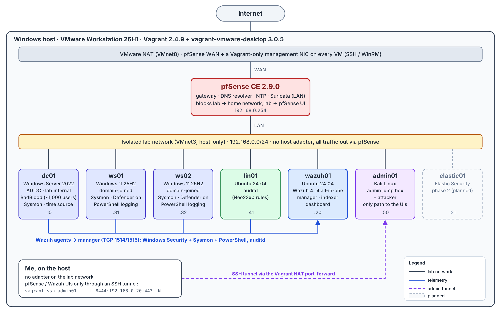

# CyberSec-Lab: SOC home lab as code (Vagrant + VMware Workstation)

An isolated Active Directory lab behind a pfSense firewall, built and checked from code, used to generate
and analyse security telemetry with Wazuh, Sysmon, auditd and Suricata.

**What it covers**
- **Infrastructure as code:** Vagrant (`vmware_desktop`) with PowerShell and bash provisioners, pinned box versions,
  and an orchestrator (`lab-build.ps1`) that builds the machines in order, checks each one and stops at the first
  failure. `-CheckOnly` validates the whole lab without changing anything.
- **Active Directory:** a Windows Server 2022 domain controller (`lab.internal`) populated with BadBlood
  (about 1,000 users, 500+ groups), two domain-joined Windows 11 workstations and an Ubuntu server.
- **Telemetry:** Sysmon (sysmon-modular config) and advanced audit policy on Windows, auditd on Linux, and a Wazuh 4.14
  manager with agents on every endpoint. Suricata IDS runs on the pfSense LAN interface.
- **Isolation:** the host has no interface on the lab network. The pfSense and Wazuh web interfaces can only be
  reached through an SSH tunnel via a Kali admin VM, and pfSense rules block lab traffic to private ranges.
- **Engineering practice:** static validation (shellcheck, PowerShell and YAML syntax, Ruby tests for the Vagrantfile),
  a troubleshooting log of real problems and fixes, documented known risks, and an explicit tested/untested status
  for each orchestrator path.

**Status:** phase 1 works end to end (validated 2026-10-21). Phase 2 (Elastic Security) is planned.

License: [MIT](LICENSE). Third-party tools (BadBlood, sysmon-modular, Neo23x0/auditd rules, Wazuh) are downloaded at
provisioning time from their own sources and keep their own licenses; they are not included in this repository.

Romanian version of the operational docs: [docs/README.ro.md](docs/README.ro.md).



---

# Operations guide

Manual steps (VMware, pfSense, host): [docs/MANUAL-SETUP.md](docs/MANUAL-SETUP.md)

Phase 1: dc01 (AD + BadBlood), wazuh01 (Wazuh AIO), ws01/ws02 (Win11, domain join, Sysmon, Wazuh agent),
lin01 (auditd, Wazuh agent), admin01 (Kali, admin + attack box). All on VMnet3, behind pfSense (192.168.0.254).
Phase 2 (decided 2026-10-21: not now): elastic01, network only, no provisioning.

**Status (2026-10-21):** all phase 1 VMs built and validated on the host
(`.\lab-build.ps1 -CheckOnly` → all OK). Static validation: `tests/validate.sh` (Ruby/YAML/PowerShell/shellcheck
+ Vagrantfile test with a stub). Still untested: the `lab-build.ps1` paths that create a machine from scratch,
reprovision ws/dc, wait for DC promotion, and detect a lost NAT forward (see "Orchestrator").

## Valid for
- Host: Windows, PowerShell 5.1, VMware Workstation 26H1, Vagrant 2.4.9, vagrant-vmware-desktop plugin 3.0.5,
  Vagrant VMware Utility (service `VagrantVMware`).
- Boxes: gusztavvargadr (versions pinned in `config/lab.yml`, release 2607), kalilinux/rolling 2026.2.0.
- Wazuh 4.14 (manager) / agent 4.14.8-1. BadBlood @ b3c6325. sysmon-modular configs-082cba578667 (Sysmon 15.21;
  the VMs run Sysmon 15.22, the "latest" Sysinternals binary).

## Address plan
| VM | IP (VMnet3) | MAC NIC0 (NAT) | NAT VMnet8 (reservation) | MAC NIC1 (VMnet3) |
|---|---|---|---|---|
| dc01 | 192.168.0.10 | 00:50:56:3A:00:0A | `<VMnet8 subnet>`.10 | 00:50:56:3B:00:0A |
| wazuh01 | 192.168.0.20 | 00:50:56:3A:00:14 | .20 | 00:50:56:3B:00:14 |
| elastic01 (phase 2) | 192.168.0.21 | ...:15 | .21 | ...:15 |
| ws01 | 192.168.0.31 | ...:1F | .31 | ...:1F |
| ws02 | 192.168.0.32 | ...:20 | .32 | ...:20 |
| lin01 | 192.168.0.41 | ...:29 | .41 | ...:29 |
| admin01 (Kali) | 192.168.0.50 | ...:32 | .50 | ...:32 |

The host has no adapter on VMnet3; it reaches the VMs only through the VMnet8 NAT port forwards (`vmnetnat.conf`)
used by `vagrant ssh/winrm`. Web GUIs are opened through an SSH tunnel via admin01 (see "GUI access").

## Host preparation (once)
```powershell
# Vagrant boxes and plugins in E:\CyberSec-Lab\VagrantBoxes (open a NEW terminal after setting this)
[Environment]::SetEnvironmentVariable('VAGRANT_HOME', 'E:\CyberSec-Lab\VagrantBoxes', 'User')
# In the new terminal: plugins live in VAGRANT_HOME, so if you changed it, reinstall:
vagrant plugin install vagrant-vmware-desktop
```
VMware Workstation 26H1 workarounds (run as Administrator; both back up to `reg-backup\`):
- `.\fix-vmware26-registry.ps1`: the utility looks for the Workstation keys under WOW6432Node; 26H1 writes them only to the 64-bit view.
- `.\fix-vmware26-dhcp-reservations.ps1`: VMnet8 DHCP reservations for every machine in `lab.yml`, under WOW6432Node.
  Run it again after adding a machine to `lab.yml`.

VM clones go to `E:\CyberSec-Lab\VMs` (`vmware_clone_directory: "VMs"` in `lab.yml`).

**Antivirus on the host (Norton, observed 2026-10-21):** Behavioral Protection reports `IDP.Generic` on
`powershell.exe` the first time a new or modified `.ps1` runs ("Unknown" reputation). False positive in the cases
checked. Procedure: compare the hash (`Get-FileHash`) with that of the version you wrote, then add an exclusion
**for the file only** (not for `powershell.exe`, not for the whole folder). Repeat after every change to the script.

## pfSense, before the first up
- Default LAN → any rule active; automatic Outbound NAT (default).
- DNS Resolver (Unbound) active on LAN: dc01 uses it as a forwarder, wazuh01 uses it directly.
- The lab's static IPs are outside the DHCP pool (.100–.200).

## Running

### Orchestrator: `lab-build.ps1`
Builds or resumes the lab in the order from `lab.yml`, checks each machine and stops at the first error.
Every `vagrant up/provision` goes through `lab-up.ps1` (log in `logs\`).
```powershell
cd E:\CyberSec-Lab
powershell -NoProfile -ExecutionPolicy Bypass -File .\lab-build.ps1 -CheckOnly       # checks only, changes nothing
powershell -NoProfile -ExecutionPolicy Bypass -File .\lab-build.ps1                  # all machines with autostart != false
powershell -NoProfile -ExecutionPolicy Bypass -File .\lab-build.ps1 -From ws01       # resume from ws01
powershell -NoProfile -ExecutionPolicy Bypass -File .\lab-build.ps1 -Only lin01 -Snapshot
powershell -NoProfile -ExecutionPolicy Bypass -File .\lab-build.ps1 -Only elastic01  # elastic01 only when named
```
- Preflight: vagrant + VMware Utility respond, DHCP reservations, disk (`-MinFreeDiskGB`, default 60), RAM,
  boxes downloaded (warning only; the Win11 box took ~2 h), `vmnetnat.conf` backup in `reg-backup\`.
- The DSRM password is asked once, at the start, only if dc01 has to be created.
- For each machine: check passes → skip; not created → up (dc01: + wait for DomainRole=5 + provision
  `dc-post,badblood,sysmon,wazuh-agent`); stopped → up; running but the check fails → reprovision only
  for ws and dc (idempotent provisioners), otherwise stop with the suggested command.
- After every change it compares `vmnetnat.conf`: a missing forward = stop.
- Exit 0 = all OK; 1 = at least one machine FAILED (the summary shows why).

| Path | Status |
|---|---|
| `-CheckOnly`, negative test (elastic01 FAIL, exit 1) | tested 2026-10-21 |
| stopped machine → started (lin01) | tested 2026-10-21 |
| create from scratch, reprovision ws/dc, wait for DomainRole=5, lost forward | **untested** |

### A single machine: `lab-up.ps1`
```powershell
powershell -NoProfile -ExecutionPolicy Bypass -File .\lab-up.ps1 -Machine ws01 -Provision -NatMac 00:50:56:3a:00:1f
powershell -NoProfile -ExecutionPolicy Bypass -File .\lab-up.ps1 -Machine dc01 -Action provision -ProvisionWith dc-post,badblood,sysmon,wazuh-agent
powershell -NoProfile -ExecutionPolicy Bypass -File .\lab-up.ps1 -Machine ws02 -Action provision -ProvisionWith tz
```
Do not run `vagrant up` without a machine name. The DSRM password is asked only if `dc-promote` runs
(first up of dc01, `provision` without a list, `--provision`, or a list that contains `dc-promote`).
`--provision-with X` runs only provisioner X (not the `run: always` ones).

After each stable stage, take a snapshot: `vagrant snapshot save dc01 post-badblood`.

## Checks after up
Quick: `.\lab-build.ps1 -CheckOnly`. Manual (inside `vagrant winrm/ssh -c '...'` avoid double quotes; PS 5.1 drops
them in transit — use `''...''`):
```powershell
vagrant winrm dc01 -c '@(Get-ADUser -Filter *).Count; Resolve-DnsName lab.internal -DnsOnly | Format-Table | Out-String' 2>&1 | Out-String
vagrant winrm ws01 -c '(Find-NetRoute -RemoteIPAddress 1.1.1.1 | Select-Object -First 1).InterfaceAlias; Get-Service Sysmon64,WazuhSvc | Format-Table Name,Status | Out-String; nltest /sc_verify:lab.internal' 2>&1 | Out-String
vagrant ssh wazuh01 -c 'sudo /var/ossec/bin/agent_control -l' 2>&1 | Out-String
Select-String C:\ProgramData\VMware\vmnetnat.conf -Pattern '^\s*\d+\s*=\s*\d'     # NAT forwards
```
Wazuh passwords (sensitive output, keep it out of logs): `vagrant ssh wazuh01 -c 'sudo tar -O -xf /root/wazuh-install-files.tar wazuh-install-files/wazuh-passwords.txt'`

## GUI access (pfSense, Wazuh)
Through an SSH tunnel via admin01, from the host (the window stays open while you use the GUI):
```powershell
vagrant ssh admin01 -- -L 8443:192.168.0.254:443 -N     # pfSense -> https://localhost:8443
vagrant ssh admin01 -- -L 8444:192.168.0.20:443 -N      # Wazuh dashboard -> https://localhost:8444 (tested 2026-10-21)
```

East-west visibility test for Suricata (on pfSense, while ws01 pings dc01):
`tcpdump -ni em1 icmp and host 192.168.0.31 and host 192.168.0.10`

## admin01 (Kali): what is automated and what is not
Automated (Vagrantfile + `scripts/common/net-kali.sh` + `scripts/admin/kali-base.sh`, on every up):
networking only through systemd-networkd (NetworkManager masked), `isolation.tools` (no copy/paste,
drag & drop or shared folders with the host), time zone from `lab.yml`, sshd key-only,
`~/.ssh/config` with `Host pfsense`.

Manual, after every `vagrant destroy` + `up` (secrets are not in the repo):
1. SSH key for pfSense, in the guest: `ssh-keygen -t ed25519 -f ~/.ssh/pfsense -C admin01-pfsense` (with a passphrase).
2. On the host: `vagrant ssh admin01 -c 'cat ~/.ssh/pfsense.pub' | Set-Clipboard` → pfSense: System → User Manager →
   admin → Authorized SSH Keys (replace the old key) → Save.
3. Test in the guest: `ssh pfsense`.
4. Password for the `vagrant` user (VMware console), on the host: `vagrant ssh admin01 -c 'sudo passwd vagrant'`.
   SSH password login is disabled anyway.

## pfSense: manual configuration (not in Vagrant)
Lives in pfSense's `config.xml`. Back up after every change: Diagnostics → Backup & Restore →
Download configuration, into `pfsense-backup/` (excluded from git: contains password hashes and keys).
- Port alias `443_22` (22, 443).
- LAN, in order: Allow DNS to pfSense; `admin01 -> pfSense mgmt` (TCP 192.168.0.50 → LAN address, port `443_22`);
  `dc01 -> pfSense NTP` (UDP 192.168.0.10 → LAN address, port 123); Block lab to RFC1918; Block lab to pfSense;
  Default allow LAN to any. The "allow" rules to pfSense must be **above** "Block lab to RFC1918":
  the RFC1918 alias contains 192.168.0.0/16, so it includes the LAN address too.
- Services → NTP: enabled, Interface = LAN + Localhost (not WAN), Time Servers `2.pfsense.pool.ntp.org` (pool).
  It is the time source for dc01 (`02-post-promote.ps1`); without the NTP rule above, dc01 stays on its local clock.
- SSH enabled, "Public Key Only"; admin01's key on the admin user.
- Anti-Lockout disabled (System → Advanced → Admin Access → "Disable webConfigurator anti-lockout rule" checked,
  confirmed 2026-10-21): pfSense GUI/SSH only through the `admin01 -> pfSense mgmt` rule. Note: the
  "Set interface(s) IP address" option in the pfSense console re-enables Anti-Lockout – check after any console change.
  If the admin01 rule breaks, emergency access is through the pfSense VMware console.
- admin user password changed 2026-10-21 (no longer the default). The password lives in the password manager, not in the repo.
- Config backup after every change, in `pfsense-backup\` (excluded from git).

## Time zone
Linux: `timezone` from `lab.yml` (`Etc/UTC`) is applied only on admin01 (`kali-base.sh`); lin01/wazuh01 stay on the
box's time zone (UTC in the 2026-10-21 logs). Windows: the `tz` provisioner (`scripts/win/timezone.ps1`, `run: always`)
sets `windows_timezone` from `lab.yml` (`UTC`). ws01/ws02 (Win11 box) came with Pacific Standard Time; dc01 was already on UTC.
dc01 is the domain time source (PDC, `tools.synctime FALSE`) and syncs NTP from pfSense
(`w32tm /config /manualpeerlist:192.168.0.254,0x8 /syncfromflags:manual /reliable:yes`, in `02-post-promote.ps1`,
env `LAB_NTP`). Verified 2026-10-21: source `192.168.0.254,0x8`, stratum 5. Other members stay on NT5DS (domain hierarchy).
Check: `vagrant winrm dc01 -c 'w32tm /query /source; w32tm /query /status' 2>&1 | Out-String`.

## Troubleshooting (problems encountered)
| Symptom | Cause | Fix |
|---|---|---|
| `Get "http://localhost:<port>/api/vmnet" ... actively refused` on any vagrant command | the `vmrest.exe` started by the utility died; the `VagrantVMware` service still shows Running | As Administrator: `Restart-Service VagrantVMware` (does not stop the VMs) |
| `Waiting for the VM to receive an address` | missing DHCP reservation under WOW6432Node or stale leases for the MAC | `.\fix-vmware26-dhcp-reservations.ps1`; `lab-up.ps1 -NatMac ...` checks the leases |
| A forward disappears from `vmnetnat.conf` after an up | rewritten by the plugin (seen once, lin01) | `vmrun -T ws stop <vmx> soft`, then `lab-up.ps1 -Machine <vm>` |
| `WinRMAuthorizationError` after DC promotion | the local account's WinRM session drops after Install-ADDSForest | fixed: promotion runs in a scheduled task (`01-promote.ps1`); the other DC provisioners are `run: never` |
| The Linux `net` provisioner exits with an error and no message (intermittent) | `ip ... \| awk '{...; exit}'` + `pipefail` → SIGPIPE on `ip` → `set -e` stops the script | fixed 2026-10-21 in `net-linux.sh`, `net-kali.sh`, `hardening.sh` (awk without `exit`) |
| Windows `net`: `Unable to set NetworkCategory ... 'Identifying...'` | NLA is still identifying the network after the IP change | fixed 2026-10-21 in `net-win.ps1` (60 s retry, then warning) |
| `Linii pcislotnumber in log: 2` (printed by `lab-up.ps1`) on non-Kali VMs | internal lines `Removing allowlisted VMX key: ethernetN.pcislotnumber` | noise; NICs are identified by MAC |
| `w32tm /stripchart /computer:192.168.0.254` → `0x800705B4` (timeout) | NTP to pfSense blocked by "Block lab to RFC1918" | `dc01 -> pfSense NTP` rule above the block rules (see pfSense) |
| Rerunning `dc-post` → "vagrant added to Schema/Enterprise Admins" | BadBlood (which removes them) skips after its marker | fixed 2026-10-21: `02-post-promote.ps1` adds them only if the `badblood` marker is missing |
| `Exception calling "Read" ... line:100` | winrm-elevated | harmless noise |
| `vagrant box add ... \| Out-String` seems stuck | `Out-String` holds the output until the end | run without `Out-String` to see progress |

## Known risks (isolated lab, not production)
- `vagrant/vagrant` stays Domain Admin (used for the join). Schema/Enterprise Admins are removed after BadBlood
  and not added back when `dc-post` reruns. Check: `vagrant` membership in the 3 groups (True/False/False).
- `LocalAccountTokenFilterPolicy=1` on ws01/ws02 (needed for Vagrant WinRM with UAC enabled).
- `wazuh-install.sh` and `Sysmon.zip` cannot be pinned by hash: they rely on TLS and the Microsoft signature, respectively.
  The Wazuh MSI is checked only for a valid Authenticode signature.
- The boxes are community builds (a single maintainer).
- Wazuh agents enroll without an enrollment password.
- Antivirus exclusions on the host for `lab-up.ps1` / `lab-build.ps1` (file only).

## Tests (CI/Linux)
`tests/validate.sh` (needs ruby ≥ 2.7, pwsh 7, shellcheck). Checks the syntax of every `.ps1`/`.sh` and `lab.yml`,
runs shellcheck at warning+ severity, and `tests/vagrantfile_test.rb`: provisioner order and type (including
`tz` on Windows, `run: never` on the DC), unique MACs and NAT reservations, VMware Tools isolation, Kali pcislotnumber.
Last run: 2026-10-21, ruby 3.3.6, pwsh 7.4.6, shellcheck 0.11.0 → OK.
