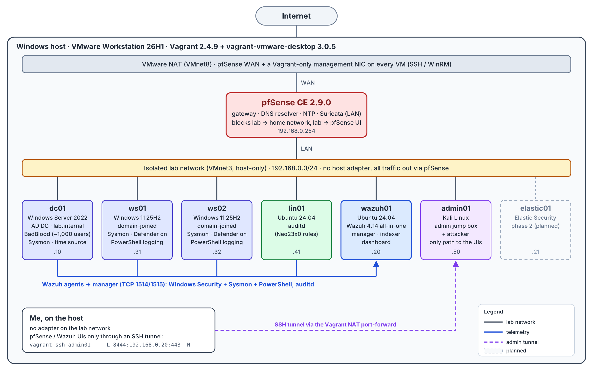

# Manual setup (everything Vagrant does not do)

Vagrant builds and provisions the six lab VMs. It does **not** create the VMware networks, the pfSense
firewall, or the host-side settings. Do these once, in this order, before the first `lab-build.ps1` run.

Valid for (verified 2026-10-21): Windows host, PowerShell 5.1, VMware Workstation 26H1 (Pro, free),
Vagrant 2.4.9, vagrant-vmware-desktop 3.0.5, pfSense CE 2.9.0.

Addresses used below are the lab defaults from `config/lab.yml` (lab network `192.168.0.0/24`).
If you change them there, change them here too.



## 1. Host software

1. Install VMware Workstation Pro, Vagrant, and the Vagrant VMware Utility (Windows service `VagrantVMware`).
2. Keep boxes and plugins on the lab drive (open a **new** terminal afterwards):
   ```powershell
   [Environment]::SetEnvironmentVariable('VAGRANT_HOME', 'E:\CyberSec-Lab\VagrantBoxes', 'User')
   vagrant plugin install vagrant-vmware-desktop
   ```
3. **Workstation 26H1 only:** the installer writes its registry keys only in the 64-bit view, and the
   Vagrant VMware Utility looks in `WOW6432Node`. Run, as Administrator (both scripts back up the
   registry to `reg-backup\` first):
   ```powershell
   .\fix-vmware26-registry.ps1
   .\fix-vmware26-dhcp-reservations.ps1   # re-run whenever you add a machine to lab.yml
   ```
   Remove both workarounds once the utility supports 26H1 (see hashicorp/vagrant#13828).

## 2. VMware networks (Virtual Network Editor)

| Network | Type | DHCP (VMware) | Host adapter | Used by |
|---|---|---|---|---|
| VMnet8 | NAT | on (default) | disabled in Windows | pfSense WAN + Vagrant management NIC of every VM |
| VMnet3 | Host-only | **off** | **not connected** | lab network behind pfSense |

- Don't attach any lab VM to a bridged network.
- The Vagrantfile puts every VM's second NIC on `VMnet3` (`network.vnet` in `lab.yml`).
- With no host adapter on VMnet3, the host can't reach lab VMs directly. Access goes through Vagrant's
  NAT port-forwards (`vagrant ssh` / `vagrant winrm`) and SSH tunnels through admin01 (section 6).

## 3. pfSense VM

1. Create a VM (FreeBSD 64-bit) with two NICs: **NIC 1 → NAT (VMnet8)** = WAN (`em0`),
   **NIC 2 → VMnet3** = LAN (`em1`).
2. Install pfSense CE 2.9.0 with the Netgate Installer (needs internet over WAN).
3. Console / setup wizard:
   - WAN `em0`: DHCP (from VMware NAT).
   - LAN `em1`: `192.168.0.254/24`.

## 4. pfSense configuration (web UI)

The first time, use the web UI from a VM on the LAN or from the host before you disconnect it from VMnet3.
After section 6 the UI is reachable only from admin01.

**Interfaces → WAN**
- Uncheck **Block private networks** and **Block bogon networks**. WAN itself sits on a private
  network (VMware NAT), so these must be off.

**Services → DHCP Server → LAN**
- Enabled, range `192.168.0.100 – 192.168.0.200`. All lab VMs use static addresses outside this range.

**Services → DNS Resolver**
- Enabled (default interfaces). dc01 uses it as its forwarder, wazuh01 uses it directly.

**Services → NTP**
- Enabled, **Interface: LAN + Localhost** (not WAN), time server `2.pfsense.pool.ntp.org` (pool).
- dc01 (the forest PDC) syncs from pfSense (`02-post-promote.ps1`); the other members follow the domain hierarchy.

**Firewall → Aliases**

| Name | Type | Content |
|---|---|---|
| `RFC1918` | Network | `10.0.0.0/8`, `172.16.0.0/12`, `192.168.0.0/16` |
| `443_22` | Port | `22`, `443` |

**Firewall → Rules → LAN**, in this exact order (IPv4 only; remove the default IPv6 allow rule):

| # | Action | Proto | Source | Destination | Port | Description |
|---|---|---|---|---|---|---|
| 1 | Pass | TCP/UDP | LAN subnets | LAN address | 53 | Allow DNS to pfSense |
| 2 | Pass | TCP | `192.168.0.50` | LAN address | `443_22` | admin01 → pfSense mgmt |
| 3 | Pass | UDP | `192.168.0.10` | LAN address | 123 | dc01 → pfSense NTP |
| 4 | Block | any | LAN subnets | `RFC1918` | any | Block lab to RFC1918 |
| 5 | Block | any | LAN subnets | This Firewall (self) | any | Block lab to pfSense |
| 6 | Pass | any | LAN subnets | any | any | Default allow LAN to any |

Order matters: the `RFC1918` alias includes pfSense's own LAN address, so every "allow to pfSense"
rule has to sit **above** rule 4. Traffic between lab VMs stays on the VMnet3 segment and never
crosses these rules; they control what the lab can reach outside itself (home network, pfSense, internet).
**Save**, then **Apply Changes**.

**System → Advanced → Admin Access**
- SSH: enabled, **Public Key Only**. The admin user's key comes from admin01 (section 6).
- Anti-lockout: **Disable webConfigurator anti-lockout rule** = checked, but only *after* rule 2 is in
  place and tested from admin01. Note: the console option "Set interface(s) IP address" turns
  anti-lockout back on.

**System → User Manager**
- Change the default `admin` password. Keep it in a password manager, not in the repo.

**Suricata**
- Installed from the package manager, running on LAN.
  [TODO: interface settings, rulesets, IPS vs IDS mode, and whether alerts are forwarded anywhere. Not documented yet.]

**Diagnostics → Backup & Restore**
- Download the configuration after every change into `pfsense-backup\` (git-ignored: it contains
  password hashes and keys). Check the file isn't a half-finished browser download (`.crdownload`).

## 5. Host firewall

Windows Firewall rule on the host: **`LAB - Block inbound VMnet8`**, Inbound, Block, all profiles.
It's there so lab VMs can't initiate connections to the host over the VMware NAT network.

[TODO: exact filters (interface alias / local and remote addresses / ports) and the one-liner to recreate it.
Read them with: `Get-NetFirewallRule -DisplayName 'LAB - Block inbound VMnet8' | Get-NetFirewallInterfaceFilter`
(and `Get-NetFirewallAddressFilter`, `Get-NetFirewallPortFilter`).]

The VMnet8 host adapter is also disabled in Windows (section 2). Vagrant still works because its
port-forwards are served by VMware's NAT service on `127.0.0.1`, not through that adapter.

**Antivirus note:** a behavioral engine (observed with Norton, `IDP.Generic`) may flag `powershell.exe`
the first time a new or modified `lab-up.ps1` / `lab-build.ps1` runs. Compare the file hash with the
version you expect, then add an exclusion for that **file only** (not `powershell.exe`, not the whole
folder). Repeat after every change to the script.

## 6. First build

```powershell
# pfSense must be running first (gateway + DNS)
powershell -NoProfile -ExecutionPolicy Bypass -File .\lab-build.ps1
```

- `lab-build.ps1` asks once for the **DSRM password** (only if dc01 doesn't exist yet). It's kept in
  memory and passed through an environment variable; it's never written to disk.
- The Windows 11 box is large (it took about two hours to download on the author's connection).
- After the build: `.\lab-build.ps1 -CheckOnly` should report every machine `OK`.

**admin01 (Kali), manual after every `vagrant destroy` + `up`:**

1. In the guest: `ssh-keygen -t ed25519 -f ~/.ssh/pfsense -C admin01-pfsense` (with a passphrase).
2. On the host: `vagrant ssh admin01 -c 'cat ~/.ssh/pfsense.pub' | Set-Clipboard`, then in pfSense:
   System → User Manager → admin → Authorized SSH Keys → paste → Save.
3. In the guest: `ssh pfsense` to test.
4. Set a password for the `vagrant` user (VMware console login): `vagrant ssh admin01 -c 'sudo passwd vagrant'`.
   SSH password login stays disabled.

**Web UIs** (keep the window open while you use them):

```powershell
vagrant ssh admin01 -- -L 8443:192.168.0.254:443 -N    # pfSense -> https://localhost:8443
vagrant ssh admin01 -- -L 8444:192.168.0.20:443 -N     # Wazuh   -> https://localhost:8444
```

Wazuh admin password (sensitive output, don't paste it into logs or tickets):
`vagrant ssh wazuh01 -c 'sudo tar -O -xf /root/wazuh-install-files.tar wazuh-install-files/wazuh-passwords.txt'`

## 7. After every `vagrant up`

- Check the NAT port-forwards are intact:
  `Select-String C:\ProgramData\VMware\vmnetnat.conf -Pattern '^\s*\d+\s*=\s*\d'`
  (`lab-build.ps1` does this automatically and stops if a forward disappeared.)
- Forwards are stored both in `vmnetnat.conf` and in the registry
  (`HKLM\SOFTWARE\VMware, Inc.\VMnetLib\VMnetConfig\vmnet8\NAT\TCPForward`). Before removing a
  "duplicate", check which port the machine actually uses with `vagrant ssh-config <vm>`.
- If every `vagrant` command fails with `Get "http://localhost:<port>/api/vmnet" ... refused`, the
  utility's `vmrest.exe` died: `Restart-Service VagrantVMware` (Administrator). Running VMs are not affected.
